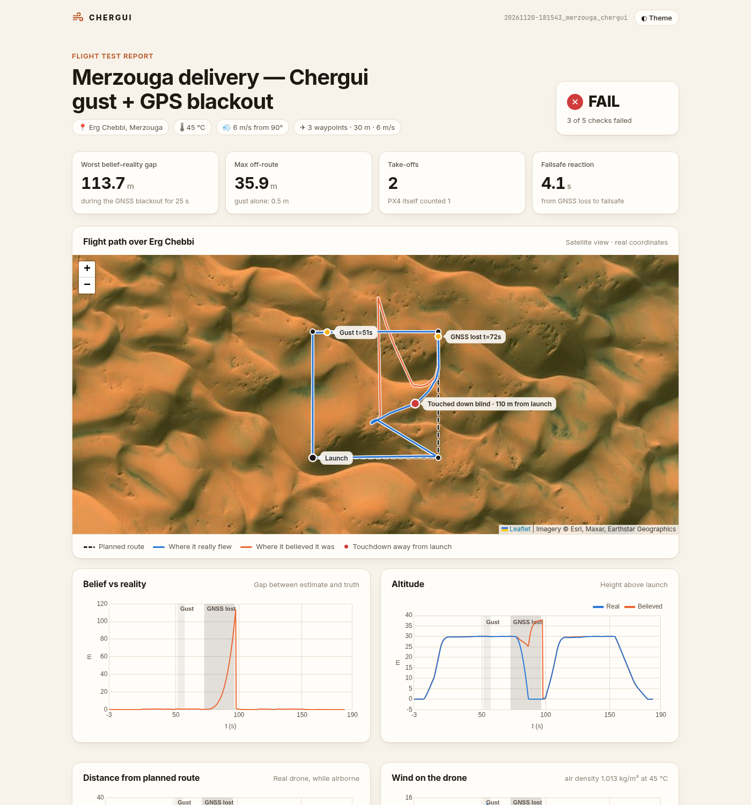

# Chergui

**Stress-test PX4 drones in simulated Moroccan Sahara conditions, judge the flight from its logs, and get the incident report written for you.**

The Chergui is the hot, dry easterly wind that blows off the Sahara across Morocco. This project throws it (and other bad days) at a drone in simulation: a delivery mission over the dunes of Erg Chebbi, in 45 °C air, with a steady Chergui, a hard gust, and a GPS blackout, all scripted, repeatable, and measured.

```
uv run chergui run scenarios/merzouga_chergui.yaml
```

One command starts Gazebo and PX4 headless, flies the mission, injects the faults on cue, lands, tears everything down, and writes a report: a satellite map of where the drone **really** flew next to where it **believed** it was, charts, rule-based verdicts, the event timeline, and an AI-written incident summary.



## What it found on the first scenario

| | |
|---|---|
| **15 m/s gust** | PX4 held the route within **0.3 m**. The controller shrugs it off. |
| **25 s GNSS blackout at 30 m** | Failsafe after **4.1 s**, then a blind drop: it **hit the sand at 6.2 m/s, 126 m from launch**. |
| **While sitting on the sand** | The drone's own estimate believed it was still moving: belief and reality drifted **199 m** apart. |
| **When GNSS came back** | It **took off again on its own** and finished the mission. PX4's land detector never registered the touchdown (it counted 1 take-off; ground truth says 2). |

**Root cause, from the log:** PX4's default height reference is GNSS (`EKF2_HGT_REF=1`). Cutting GNSS also killed the vertical estimate, which blinds the land detector (it needs vertical velocity) and turns the controlled LAND into an uncontrolled descent. With barometer height (`EKF2_HGT_REF=0`), the same blackout gives a controlled **0.7 m/s** descent and no rogue take-off.

## AI mission planning: intent in, verified mission out

```
uv run chergui mission "a hiker is missing in the dunes east of camp; search the area in a strong midday chergui, GPS drops out halfway, bring the drone back"
```

1. The AI turns the sentence into a **test** (place, weather, faults, task, pass/fail rules). You approve it; then it's locked.
2. The AI writes a **plan**: altitude, speed, survey spacing and direction, and a few allowlisted PX4 settings. It never writes coordinates; waypoints are generated in code.
3. Deterministic pre-flight checks, then the flight, then the fixed rules.
4. The AI reads the verdicts and the log evidence and revises. The loop always ends: all rules pass, the flight budget is spent (`--budget`, default 4), or the AI says nothing it may change would help.

**What happened the first time:** to get through a GNSS blackout, the planner postponed PX4's failsafe and then raised the position-loss trigger to 300 m, all inside the allowlist. So the allowlist now only lets safety settings get **stricter** than PX4's defaults. With that rule, the planner's revised plan (barometer height, east-west passes) passes all six rules. The same test doesn't always produce the same plan, which is exactly why the rules, not the model, decide.

Every mission writes `runs/missions/<id>/mission.html`: the locked test, every attempt's real path on the satellite map, rules x attempts, and the AI's reasoning per attempt.

## How it works

```
scenario.yaml ──► runner ──────────────► Gazebo (sahara world) ◄── wind bridge ◄── wind model
                    │                        ▲                    (ApplyLinkWrench)  (drag, 1-cos gust)
                    │                        │
                    ├──► PX4 SITL (standalone, fresh params every run)
                    │        ▲
                    └──► MAVSDK: health gate, mission, faults (EKF2_GPS_CTRL), telemetry, events
                                 │
                       flight.ulg + run.json
                                 │
                    analyze (pyulog): estimate vs ground truth, route deviation,
                    touchdowns, failsafe timing → deterministic verdicts
                                 │
                    report.html  +  AI summary (OpenAI; explains, never judges)
```

| Module | Job |
|---|---|
| `scenario.py` | One YAML file = one fully specified, repeatable experiment, validated on load |
| `sim.py` | Launches Gazebo + PX4, per-run working dir (no parameter leakage), clean teardown |
| `wind.py` + `bridge/wind_bridge.py` | Turns wind speed into force on the airframe and pushes it into Gazebo |
| `vehicle.py` | MAVSDK: readiness gate, mission upload, GNSS cut, telemetry and event log |
| `planning.py` | Plan → waypoints (survey / delivery), PX4 settings allowlist, pre-flight checks |
| `agent.py` | Intent → locked test → plan / fly / judge / revise loop |
| `mission_report.py` | Single-file HTML report comparing attempts |
| `runner.py` | Orchestrates one run and keeps the evidence even when a run goes wrong |
| `analyze.py` | Judges the flight from the log with fixed rules |
| `summary.py` | LLM incident write-up from the measured numbers only |
| `report.py` | Single-file HTML report |

## Design decisions (and why)

- **Ground truth vs estimate is the core metric.** In simulation PX4 logs both `vehicle_global_position` (what the EKF believes) and `..._groundtruth` (what Gazebo says). Real flights never have the second one. Comparing them shows exactly how a fault corrupts the drone's picture of the world.
- **Verdicts are deterministic; the AI only explains.** Pass/fail comes from thresholds in the scenario file, so the same log always gets the same verdict. The model receives the measured numbers and the timeline, and is told to cite them.
- **Touchdowns are judged from ground truth, not PX4's land detector.** The first scenario showed why: during the blackout PX4 sat on the sand without ever detecting a landing.
- **Wind as force, with real air density.** `F = ½·ρ·CdA·|v|·v`, with v the wind relative to the drone (its true velocity comes from Gazebo's pose stream) and ρ from temperature and elevation (45 °C at 760 m gives ρ ≈ 1.01 kg/m³, vs 1.225 at sea level). Gusts use the standard aviation 1-cosine profile. A first version used ground-relative wind, and a drifting drone accelerated past the wind speed; caught and fixed by checking true ground speed in the log.
- **PX4 settings at boot.** A scenario's `px4_params` are passed as `PX4_PARAM_<name>` environment variables, so even reboot-required settings like `EKF2_HGT_REF` apply.
- **A separate wind-bridge process.** Gazebo's Python bindings ship for the system Python 3.10, the project runs on 3.13, and the `gz` CLI takes ~3 s per call, far too slow to shape a gust. A small bridge process on system Python streams forces at 20 Hz.
- **GNSS loss at the estimator.** PX4's `failure gps off` isn't implemented for Gazebo Harmonic, so the blackout sets `EKF2_GPS_CTRL=0` (the EKF stops fusing GNSS) and restores it to 7.
- **Real place, real physics constants.** The world uses Erg Chebbi's coordinates and Merzouga's magnetic field (WMM), so the magnetometer agrees with what PX4 expects for its GPS position.
- **Fresh PX4 working directory per run.** PX4 persists parameters; without isolation, one run's GNSS cut would leak into the next.

### A Gazebo gotcha worth knowing

`ApplyLinkWrench` persistent wrenches **accumulate**: every message is added to the link's list, it doesn't replace the previous one. And a `clear` sent in the same instant as a new wrench can be processed after it, silently zeroing the force. Measured with a lift test (two +12 N pushes lift a 2 kg drone, one doesn't; a −30 N push cancels a +30 N one). The bridge therefore sends only force *changes* and periodically resyncs.

## Quick start

Requirements: Ubuntu 22.04, [PX4-Autopilot](https://github.com/PX4/PX4-Autopilot) built for SITL (`make px4_sitl`), Gazebo Harmonic with `python3-gz-transport13`, and [uv](https://docs.astral.sh/uv/).

```bash
git clone <this repo> && cd chergui
uv sync
echo 'OPENAI_API_KEY=sk-...' >> .env      # optional, for the AI summary
uv run chergui run scenarios/merzouga_chergui.yaml          # headless
uv run chergui run scenarios/merzouga_chergui.yaml --gui    # also open Gazebo, for recording
uv run chergui report runs/<run-dir>                        # rebuild a report
uv run chergui mission "describe the mission in words"      # AI plans, flies, revises
```

Set `PX4_DIR` if PX4 isn't in `~/PX4-Autopilot`. Each run lands in `runs/<timestamp>_<scenario>/` with the flight log, `run.json`, `analysis.json` and `report.html`.

## Writing a scenario

```yaml
location: { name: Erg Chebbi, Merzouga, lat: 31.1330, lon: -3.9790, alt_m: 760 }
environment:
  air_temp_c: 45
  wind: { speed_ms: 6, from_deg: 90 }        # Chergui: easterly
mission:
  altitude_m: 30
  speed_ms: 6
  waypoints_ne_m: [[120, 0], [120, 120], [0, 120]]   # metres north/east of launch
faults:
  - { type: gust, at_waypoint: 1, delay_s: 4, duration_s: 6, speed_ms: 15, from_deg: 90 }
  - { type: gps_loss, at_waypoint: 2, delay_s: 2, duration_s: 25 }
criteria:
  max_estimate_error_m: 15
  max_path_deviation_m: 30
  max_landing_distance_m: 10
```

Faults trigger at a time (`at_s`) or once a waypoint has been reached (`at_waypoint`).

## Limitations (honest list)

- Drag is a single body drag area; no rotor inflow or propwash effects from wind.
- Heat only affects drag here; real hot air also reduces rotor thrust, which isn't modelled yet.
- GNSS loss is at the estimator (EKF stops fusing GNSS), not a receiver losing its fix.
- Flat sand ground plane; the satellite map shows the real dunes, the physics doesn't have them yet.

## Roadmap

- Gust-speed sweeps: run the same mission from 0 to 20 m/s and chart where it starts failing
- Dune terrain from real elevation data
- Thrust derating in hot air, sensor noise from dust, magnetometer interference
- VTOL / fixed-wing airframes for long-range desert routes

Built with PX4, Gazebo Harmonic, MAVSDK, pyulog, Leaflet and Chart.js.
